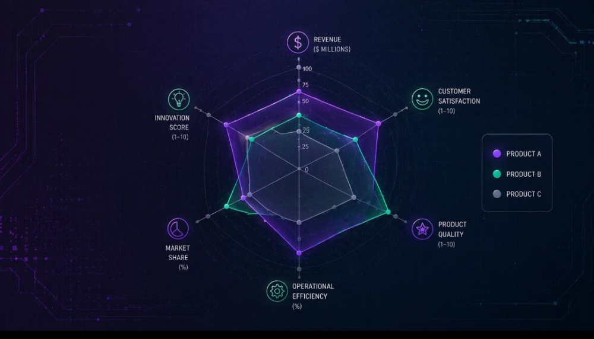
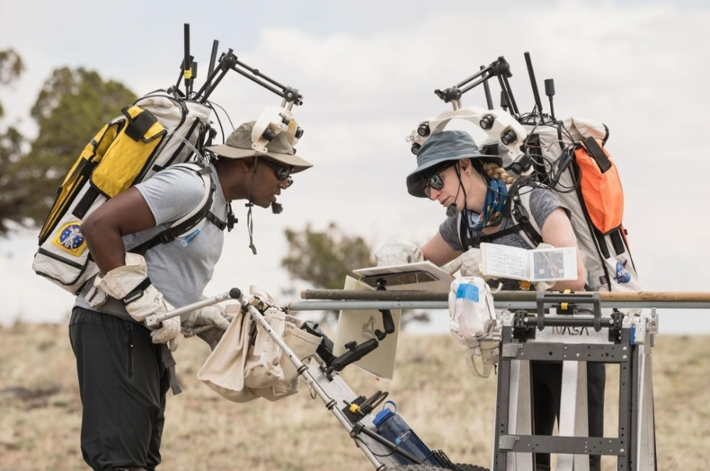
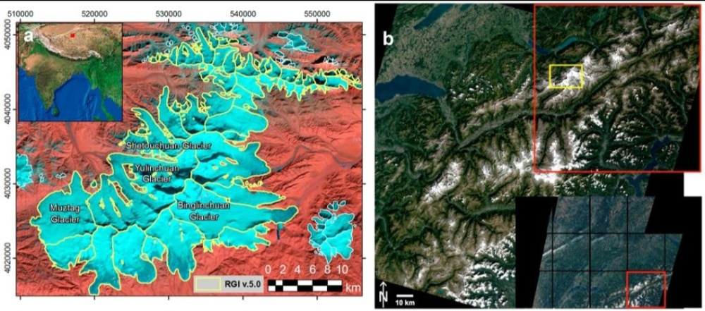
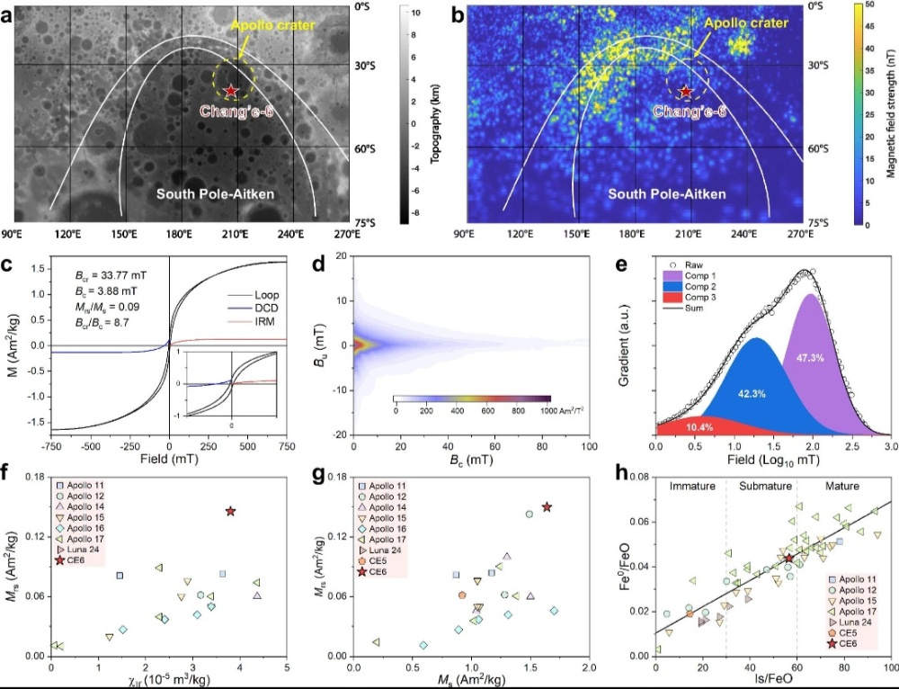
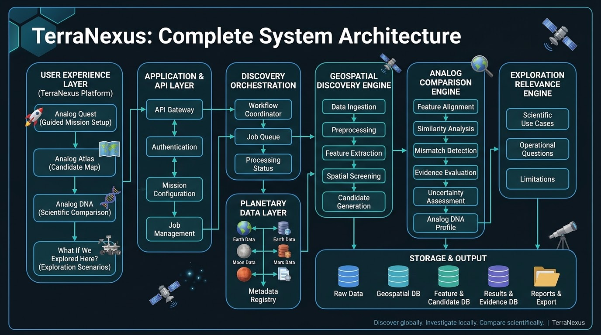

# TERRANEXUS — Global Planetary Analog Discovery System

> **Discover globally &nbsp;✦&nbsp; Investigate locally &nbsp;✦&nbsp; Compare scientifically**  
> *NASA International Space Apps Challenge 2026*

[](https://vitejs.dev/)
[](https://react.dev/)
[](https://threejs.org/)
[](https://www.python.org/)
[]()
[]()
[](./LICENSE)
[](https://earthdata.nasa.gov/)

---

## 1. The Product Vision

**TerraNexus** is a **Global Planetary Analog Discovery System** that systematically searches Earth's environments to identify, characterize, and evaluate potentially overlooked locations that could serve as scientifically useful analogues for lunar and Martian exploration.

Rather than retrieving an arbitrary catalog of predefined, famous field sites, TerraNexus analyzes open Earth observation, geospatial, geological, and planetary datasets. It extracts physical environmental features, detects candidate locations across defined geographic extents, and benchmarks them against genuine Moon and Mars reference records from NASA's Planetary Data System (PDS), Earthdata, and USGS Astrogeology.

```
       ┌────────────────────────────────────────────────────────┐
       │              EARTH → MOON / MARS DISCOVERY             │
       │                                                        │
       │   Global Earth Observation & Geospatial Ingestion     │
       │                          ▼                             │
       │   Automated Feature Extraction & Candidate Detection   │
       │                          ▼                             │
       │  Multi-Dimensional Planetary Reference Benchmarking    │
       │                          ▼                             │
       │    Evidence-Based Scientific Profile ("Analog DNA")    │
       └────────────────────────────────────────────────────────┘
```

### The Core Promise

TerraNexus helps researchers, mission planners, and planetary scientists discover:

* **Where:** Which Earth locations emerge as potentially useful planetary analogue candidates?
* **Why:** Which measurable environmental, geomorphological, or geological characteristics make them relevant?
* **How:** What quantitative empirical evidence supports each comparison, and what is its confidence?
* **What differs:** Which planetary conditions are fundamentally **not** represented by the terrestrial candidate?
* **What next:** What scientific questions, instrument test campaigns, rover mobility trials, or astronaut training activities could the site realistically support?

> **Scientific Goal:** Not to declare "perfect" analogues—because no terrestrial environment reproduces $0.166\text{ g}$, hard vacuum, or unshielded cosmic rays—but to systematically surface promising candidates and make their scientific relevance understandable, verifiable, and reproducible.

---

## 2. Global Discovery Architecture: Earth → Moon / Mars

TerraNexus starts with **Earth**. Rather than requiring users to manually select a planetary target before searching, the engine analyzes geographic areas across global Earth coverage to surface candidate terrains.

### The 8-Step Discovery Process

```
 1. Search Globally          4. Extract Features         7. Surface Overlooked Sites
 [Define Earth Coverage]  ──► [Derive Spatial Indices] ──► [Present Evidence & Gaps]
          │                           │                            ▲
          ▼                           ▼                            │
 2. Acquire Earth Data       5. Detect Candidates         6. Planetary Comparison
 [PDS, GIBS, USGS, DEMs]  ──► [Screen Combinations]    ──► [Benchmark Moon / Mars]
          │
          ▼
 3. Harmonize Observations
 [Grid, Datum, Projection]
                                                          8. Investigate Locality
                                                          [Analog DNA & 3D Terrain]
```

1. **Search Globally:** Define the geographic extent to evaluate, expanding toward global coverage.
2. **Acquire Earth Data:** Ingest open observation layers covering topography, slope, roughness, surface temperature, multispectral geology, and water/ice indicators.
3. **Harmonize Observations:** Standardize spatial resolutions, coordinate reference systems (CRS), units, and temporal coverage across disparate satellite instruments.
4. **Extract Environmental Features:** Compute quantitative terrain metrics (TRI roughness, windowed relief, local slopes, thermal diurnal envelopes).
5. **Detect Candidate Environments:** Screen spatial combinations to locate regions matching target criteria.
6. **Compare with Planetary References:** Benchmark candidates against lunar (LRO LOLA/Diviner) and Martian (MGS MOLA/TES, Mars 2020 MEDA) reference records.
7. **Surface Overlooked Candidates:** Rank candidates by dimension-level findings, empirical distributions, identified mismatches, and quantified uncertainties.
8. **Investigate Discovered Locations:** Allow scientists to drill down into high-resolution 3D site meshes, evaluate exploration scenarios, and export peer-review-ready dossiers.

---

## 3. The Signature Experience

TerraNexus integrates three interconnected modules:

```
┌─────────────────────────────────────────────────────────────────────────────┐
│                             TERRANEXUS PLATFORM                             │
├─────────────────────────┬─────────────────────────┬─────────────────────────┤
│    A · ANALOG QUEST     │     B · ANALOG DNA      │ C · WHAT IF WE EXPLORED │
│                         │                         │          HERE?          │
│  The Discovery Journey  │ The Scientific Profile  │  The Investigation Hub  │
│                         │                         │                         │
│ • Mission launcher      │ • Multidimensional      │ • Rover mobility tests  │
│ • Planetary context     │   radar comparisons     │ • Instrument validation │
│ • Dimension filter      │ • Empirical p10–p90     │ • Dust / erosion trails │
│ • Automated screening   │   percentile envelopes  │ • Planetary boundary    │
│ • Candidate surfacing   │ • Evidence state rubric │   condition guardrails  │
└─────────────────────────┴─────────────────────────┴─────────────────────────┘
```

### Module A — Analog Quest: The Discovery Journey
Launches mission-focused exploration runs. Users configure planetary target contexts (Moon South Pole, Mars Jezero Crater, or dual-reference mode) and activate target dimensions to screen global candidate environments.

### Module B — Analog DNA: The Scientific Explanation Layer
Provides an exhaustive multidimensional profile of each site. Rather than collapsing complex science into an uninformative single percentage, Analog DNA provides:
* Radar chart profiles across all scientific dimensions.
* Continuous percentile distributions ($p_{10}, p_{25}, p_{50}, p_{75}, p_{90}$, mean, standard deviation).
* Distribution overlap ratios ($\ge 40\%$ decision threshold).
* Explicit documentation of missing parameters, data limitations, and sensor uncertainties.


*Figure 3: Analog DNA Multidimensional Scientific Comparison Radar Analysis — Evaluating multidimensional features of candidate analogue sites relative to lunar and Martian targets.*

### Module C — "What If We Explored Here?": The Investigation Layer
Translates scientific data into practical exploration test scenarios:
* **Rover Mobility & Geomechanics:** Assessing whether local slopes, boulder distributions, and roughness simulate rover traction and obstacle negotiation.
* **Instrumentation & Sensor Validation:** Evaluating whether surface mineralogy or thermal cycles offer realistic test benches for spectrometers, thermal imagers, or drill assemblies.
* **Operational Boundary Guardrails:** Identifying non-transferable planetary physics before field campaigns are funded.


*Figure 4: Field Exploration Scenario & Instrument Testing Setup — Scientific field validation, mobility studies, and equipment testing scenarios mapped onto terrestrial candidates.*

---

## 4. The Analog Atlas & Interactive 3D Workspaces

The **Analog Atlas** serves as the central interactive visual workspace, featuring custom WebGL/Three.js rendering engines:


*Figure 5: Candidate Environment Screening and Geospatial Analysis Map — Geospatial candidate comparison, environmental feature detection, and multi-scale regional coverage.*

### Visual Workspaces & Layers
* **Interactive 3D Planetary Globes:**
  * **Earth:** NASA Blue Marble true-color imagery with city lights fading through twilight, an astronomical sub-solar terminator, and keyless **Live Cloud Mosaics** streamed directly from NASA GIBS (VIIRS true-color corrected reflectance).
  * **Moon:** High-resolution LRO LROC color mosaic paired with LOLA digital elevation models and real-time phase illumination.
  * **Mars:** Viking MDIM 2.1 colorized mosaic oriented by NASA GISS's Mars24 algorithm for accurate sub-solar longitude, season ($L_s$), and polar cap daylighting.
  * **Sky:** NASA Deep Star Maps 2020 oriented to true Greenwich sidereal time.
* **3D Site Terrain Mesh & Overlays:**
  * Procedural 3D elevation meshes generated from digital elevation tiles.
  * **Hypsometric Altitude Map:** Color-mapped relief using an identical mathematical ramp in the 3D scene and on-screen legend.
  * **NASA GIBS Land Surface Temperature (LST) Overlay:** Vertex-baked 8-day composite thermal imagery decoded from the official MODIS colormap, with automated date-fallback and high-precision legend ticks ($0.1\text{ }^\circ\text{C}$ resolution).

---

## 5. Interface Guide & How to Use (Step-by-Step)

Everything runs client-side in the browser. The web application ships ready-to-run with 13 pre-loaded terrestrial analogue sites and genuine NASA planetary records.

### The Screen at a Glance

```
+---------------------------------------------------------------------------------+
| TERRANEXUS                      [ Sample Data / Live API ] NASA Space Apps 2026 |
| Target: [Moon | Mars]  Terrain: [All][Desert 3][Polar 2]...  Sites: 13  Fit: 0.68|
+-------------------+---------------------------------------+---------------------+
| DISCOVERY QUEUE   |            HERO 3D GLOBE              |    SITE DOSSIER     |
| [ Search... (/) ] |    Interactive WebGL Earth Sphere     | Atacama Desert      |
| Sort: Best Fit    |       Beacons sized & coloured        | 0.84 Moon Fit       |
| 01 Atacama  0.84  |                                       | Moon vs Mars bars   |
| 02 Haughton 0.62  |     [ Clouds ]       [ Reset View ]   | 4 Pillar Breakdown  |
| 03 McMurdo  0.58  |                                       | [ See Site 3D ]     |
| ...               | Bottom Bar: Selected Site Coordinates | [ Orbit vs Ground ] |
| REPORTED SITES    |                                       | [ Export ] [ Share ]|
| [+ Report Site]   |                                       | Researcher Signal   |
+-------------------+---------------------------------------+---------------------+
| > EVIDENCE & PROVENANCE (Expandable Drawer)                                     |
|   Fit Distribution  |  Feature Influence  |  Live Moon Target  |  Data Sources  |
+---------------------------------------------------------------------------------+
```

### Core Interface Zones

1. **Top Bar & Control Band:**
   - **Target Switch:** Toggle between **Moon** and **Mars**. Instantly updates all candidate rankings, beacon colors, and planetary dossiers.
   - **Terrain Family Chips:** Click `Desert`, `Polar`, `Volcanic`, `Arid`, `Cave`, `Impact`, or `Fluvial` to filter the queue and globe. Click active chip to return to `All`.
   - **Real-Time KPIs:** Live counts of active sites, average fit score, count of strong matches ($> 0.72$), and loaded NASA datasets.

2. **Discovery Queue (Left Panel):**
   - **Instant Search (`/`):** Filter by site name, country, or region (diacritics ignored: typing `"rio"` matches *Río Tinto*).
   - **Sort Menu:** Sort by *Best Fit*, *Moon Fit*, *Mars Fit*, or *Alphabetical*.
   - **Ranked Candidate Cards:** Click any card to select the site, rotate the 3D globe, and open its detailed scientific dossier.
   - **Community Reported Sites:** Shows researcher-submitted unreviewed candidates (flagged with amber beacons). Manage via the `Manage` button.

3. **Hero 3D Globe (Center Workspace):**
   - **Navigation:** Click and drag to orbit; scroll or pinch to zoom.
   - **Drag-Safe Selection:** Dragging the mouse rotates the globe without accidental site selection. Only a stationary click on a beacon selects a site.
   - **Camera Fly-In:** Clicking a site beacon initiates a smooth cinematic camera flight that dives directly onto the site and opens the 3D local terrain view.
   - **Live Cloud Overlay:** Click **"Clouds"** (bottom right of globe) to stream genuine **NASA GIBS VIIRS** true-color satellite mosaics for any day in the last 60 days.

4. **Site Dossier (Right Panel):**
   - **Planetary Breakdown:** Large headline score with comparative Moon vs. Mars fit bars.
   - **Scientific Pillars:** 4-pillar balance: *Geomorphology*, *Mineralogy*, *Environment*, and *Logistics*.
   - **Provenance Chips:** Clickable source badges linking directly to NASA PDS and Earthdata repositories.
   - **Action Buttons:**
     - **"See Site":** Opens the curated Wikimedia Commons high-resolution field photography gallery.
     - **"Orbit vs Ground":** Opens side-by-side split screen comparing satellite imagery (at 50 km, 15 km, 4 km) with ground-truth field photos.
     - **"Export CSV":** Downloads the currently filtered and ranked candidate list.
     - **"Copy Link":** Generates a shareable URL preserving target body, active filters, and selected site.
   - **Researcher Signal:** Upvote toggle, peer reviews, and verified field notes.

5. **3D Site Terrain Mesh View (Local Dive):**
   - Opens when clicking a beacon or selecting **"See Site 3D"**.
   - Renders a 7 km elevation crop at 30 m resolution with an interactive pulsing coordinate marker.
   - **Hypsometric Altitude Overlay:** Shows topographic relief from low ground to summits.
   - **MODIS Surface Temperature Overlay:** Toggles vertex-baked land surface temperature derived from NASA GIBS with an automated 32-day composite fallback and $0.1\text{ }^\circ\text{C}$ resolution colormap legend.
   - Press **`Esc`** or click **"Back to Globe"** to exit the terrain view.

6. **Evidence & Provenance Drawer (Bottom):**
   - Click to expand: displays the fit score distribution histogram, model feature influence, astronomical Moon phase tracker, and complete NASA dataset catalog.

---

### Step-by-Step Task Recipes

#### A. Compare Moon vs. Mars for a Candidate Site
1. Select the site (e.g., *Atacama Desert* or *Haughton Impact Crater*).
2. Look at the **Site Dossier** on the right: the side-by-side bars display both Moon and Mars fit.
3. Toggle the **Target switch** in the top bar to flip the active baseline and re-rank the global queue.

#### B. Dive into Local 3D Terrain & View Thermal Heat Map
1. Click any site beacon on the 3D globe.
2. The camera dives down onto the 7 km ground mesh.
3. In the overlay toolbar (bottom left), click **"Heat Map"**.
4. The mesh vertex colors will bake the real MODIS 8-day land surface temperature composite, and the left rail will display the exact degree scale.
5. Drag to rotate and inspect slope relief; press **`Esc`** to return to global view.

#### C. Inspect Orbit vs. Ground Truth
1. In the Site Dossier, click **"Orbit vs ground"**.
2. Left pane displays NASA GIBS satellite passes (switchable between 50 km, 15 km, and 4 km resolutions).
3. Right pane displays ground-level geological fieldwork photographs.
4. Use the date picker to inspect historical satellite passes across different seasons.

#### D. Report a New Candidate Analogue
1. In the left panel, click **"+ Report a site"**.
2. Enter the site name, latitude, longitude, terrain family, target planetary body, and field evidence description (minimum 20 characters).
3. Submit: the site immediately appears with an amber beacon on the globe and is catalogued under "Reported Candidates".
4. Export community submissions as JSON or CSV using the **"Manage"** button.

---

### Keyboard Shortcuts

| Shortcut | Action |
|---|---|
| **`/`** | Focus search field |
| **`↑` / `↓`** | Walk up/down through the ranked candidate list |
| **`Enter`** | Select focused site / activate button |
| **`Esc`** | Exit 3D terrain view, close modals/galleries, or clear search |
| **`←` / `→`** | Previous / Next photo (in field gallery) |
| **`Home` / `End`** | Jump to first / last photo (in field gallery) |

---

## 6. Scientific Dimensions & Comparison Engine

The engine evaluates candidates across **8 scientific dimensions**:

| # | Dimension | Measurable Parameters & Target Datasets |
|---|---|---|
| **1** | **Terrain & Topography** | Slope angle distributions, Terrain Ruggedness Index (TRI), windowed relief ($3\times 3$), elevation range (USGS SRTM, LRO LOLA, MGS MOLA). |
| **2** | **Surface & Geology** | USGS Global Crosswalk lithologies, rock abundance photogrammetry, mineral suites, clay/sulfate evaporites (CRISM, SuperCam). |
| **3** | **Temperature & Thermal** | Diurnal temperature amplitude, surface kinetic temperature, thermal inertia (MODIS Terra LST, LRO Diviner, MGS TES, Mars 2020 MEDA). |
| **4** | **Solar Illumination** | Annual daylight fraction, grazing incidence elevation ($\pm 1.5^\circ$), PSR shadowing, sol day/night cycles, irradiance flux (LOLA Polar Illumination, ephemeris models). |
| **5** | **Water & Ice** | Spectral hydration bands, geomorphological permafrost indicators, patterned ground, glaciovolcanic features. |
| **6** | **Atmospheric & Aeolian** | Aeolian saltation, yardangs, dune morphology, dust storm optical depth attenuation ($\tau = 0.5$). |
| **7** | **Biology & Habitability** | Hyper-arid microbial thresholds, endolithic microhabitats, UV-radiation survival limits. |
| **8** | **Subsurface Environments** | Lava tubes, collapse pits, skylight geometry, radar dielectric sounding. |

### Evidence State Taxonomy

TerraNexus uses a formal 4-state scientific classification:

* 🟢 **`SIMILAR`**: Empirical distributions share $\ge 40\%$ overlap ratio, or geological classification groups align.
* 🔴 **`DIFFERENT`**: Quantified divergence below threshold ($< 40\%$ overlap) with documented offset direction.
* 🟡 **`INSUFFICIENT_EVIDENCE`**: Sensor resolution inadequate, data missing, or regional coverage below minimum valid threshold ($< 40\%$).
* ⚪ **`NOT_COMPARABLE`**: Fundamental physical or mathematical incompatibility (e.g., Earth mean sea-level geoid vs Moon geometric sphere).

### Universal Physical Limitations

Every candidate dossier explicitly appends the four unbridgeable physical constraints:

1. **Gravity Disparity:** Earth ($1.00\text{ g}$) vs Moon ($0.166\text{ g}$) vs Mars ($0.38\text{ g}$). Equal slope angles are **not** equally hazardous across gravitational regimes.
2. **Atmospheric Pressure:** Earth ($1,013.25\text{ hPa}$) vs Moon ($\sim 10^{-12}\text{ hPa}$, vacuum) vs Mars ($\sim 6\text{ hPa}$, $\text{CO}_2$). Absence of convective cooling and liquid water stability.
3. **Ionizing Radiation:** Earth's magnetospheric shielding vs unattenuated galactic cosmic rays (GCR) and solar particle events (SPE).
4. **Regolith & Weathering:** Terrestrial organic binders and aqueous weathering vs sharp, unweathered, electrostatic, agglutinated lunar/Martian regolith.

---

## 7. End-to-End User Workflow

The discovery platform guides researchers through a 10-step sequence:

```
  01 Start Discovery Mission   ──►  02 Define Planetary Context   ──►  03 Select Dimensions
  [Launch Analog Quest]            [Moon South Pole / Mars Jezero]     [Terrain, Geology, Thermal...]
                                                                                │
  06 Planetary Comparison      ◄──  05 Detect Candidate Envs      ◄──  04 Acquire & Prepare Data
  [Benchmark distributions]        [Feature screening algorithms]      [Harmonize open Earth layers]
         │
         ▼
  07 Explore Analog Atlas      ──►  08 Investigate Analog DNA     ──►  09 Evaluate Exploration
  [Interactive 3D globes]          [Inspect percentiles & gaps]        [Review test-use scenarios]
                                                                                │
                                                                                ▼
                                                                       10 Export Report
                                                                       [Audited scientific dossier]
```


*Figure 2: Empirical Data Evidence & Spectral Analysis for Scientific Report — Comprehensive empirical evidence, dataset provenance, and analytical spectra included in generated candidate dossiers.*

---

## 8. System Technical Architecture

The TerraNexus platform is structured around six core modules:
1. **Discovery Interface:** Analog Quest mission launcher, planetary context selection, and dimension configuration.
2. **Planetary Data Layer:** Earth observation streams, Moon/Mars PDS repositories, and provenance metadata registry.
3. **Geospatial Discovery Engine:** Raw data ingestion, spatial harmonization, feature extraction, and candidate screening.
4. **Analog Comparison Engine:** Statistical feature comparison, similarity/mismatch analysis, and uncertainty bounds.
5. **Scientific Investigation Engine:** Exploration prompts, operational research use cases, and physics guardrails.
6. **Experience & Output Layer:** 3D Analog Atlas viewer, Analog DNA profiler, and peer-review-ready report generation.


*Figure 1: TerraNexus Complete System Architecture Flow Diagram — End-to-end data flow from open satellite archives through discovery screening, comparison, and 3D visualization.*

### Codebase Organization

```
NASA-SPACE-APPS-2026/
├── config/                      # Ingestion & crosswalk configurations
│   ├── datasets.json            # Remote dataset discovery catalog
│   ├── geology_crosswalk.json   # USGS terrestrial-to-planetary lithology crosswalk
│   └── settings.json            # Regional coordinates & pipeline limits
├── data/                        # Planetary & Earth raster data
│   ├── raw/                     # Immutable raw source downloads (PDS, Earthdata)
│   ├── interim/                 # Harmonized intermediate grids
│   ├── processed/               # Extracted features & spatial matrices
│   └── samples/                 # Lightweight sample arrays for verification
├── docs/                        # Authoritative architecture & handoff guides
│   ├── images/                  # Extracted architecture & analysis diagrams
│   ├── comparison_engine_handoff.md
│   ├── site_classification_and_onboarding_guide.md
│   └── data_dictionary.md
├── reports/                     # Canonical pre-computed comparison dossiers (JSON)
│   ├── comparison_results_atacama_vs_moon.json
│   └── comparison_results_atacama_vs_mars.json
├── scripts/                     # Automation & validation scripts
│   ├── audit_deliverables.py    # 224-point automated reliability audit
│   └── run_comparison.py        # Master pipeline execution script
├── src/
│   ├── comparison/              # Core Python scientific comparison engine
│   │   ├── engine.py            # Master comparison orchestrator
│   │   ├── geology_crosswalk.py # Surface rock & mineralogy crosswalk
│   │   ├── illumination_evaluator.py # LOLA/ephemeris solar evaluator
│   │   ├── models.py            # Typed dataclasses & Pydantic models
│   │   ├── statistics.py        # Wasserstein distance & overlap ratios
│   │   ├── terrain_metrics.py   # Slope, TRI roughness, and relief
│   │   └── thermal_evaluator.py # Diviner/TES thermal inertia & amplitude
│   ├── components/              # React UI & WebGL visualization
│   │   ├── panels/              # SiteInspector, RankedQueue, FilterBar
│   │   └── three/               # Globe, SiteTerrain (3D mesh), MoonMap, MarsMap
│   ├── lib/                     # Algorithms, coordinate formatters, math
│   │   ├── classification.ts    # Frontend classification engine
│   │   ├── terrainScale.ts      # Colormap decoders & dynamic scale ticks
│   │   └── astro.ts             # Ephemeris, sub-solar coordinates, sidereal time
│   └── styles.css               # Production styling & responsive layouts
└── tests/                       # Automated test suites
    ├── test_comparison.py       # Engine logic & physics guardrails (10 tests)
    └── test_pipeline.py         # Ingestion, terrain math, PDS3 parsing (58 tests)
```

---

## 9. Scientific Guardrails & Principles

* **Discover beyond known analogues:** Use existing catalogues (e.g. MDRS, FMARS, HI-SEAS) for historical reference and validation, not as a boundary on discovery.
* **Look beyond visual resemblance:** Red sand does not make a Mars analogue; hypersaline perchlorates, duricrust thermal inertia, and extreme aridity do.
* **Zero composite scores:** Never generate misleading single percentages ("82% match"). Dimensions are physically orthogonal and must remain independent.
* **Keep provenance unbroken:** Every comparison links back to open PDS, Earthdata, or USGS repository identifiers and native sensor resolutions.
* **Treat mismatches as discovery:** Knowing where an Earth site fails to match a planetary target is what prevents catastrophic equipment failure in space.

---

## 10. Team Roles & Leadership

| Team Member | Domain & Role | Core Responsibilities |
|---|---|---|
| **Chaima** | **Product Direction & System Integration** | Product vision, cross-team workflow orchestration, user experience storytelling, and system roadmap. |
| **Zehra** | **Scientific Criteria & Validation** | Planetary science criteria, literature reference baselines, physical limitation definitions, and comparability validation. |
| **Harshil** | **Machine Learning & AI / Comparison Engine** | Comparison engine architecture, feature extraction algorithms, statistical overlap models, and deliverable reliability audits. |
| **Abid** | **Geospatial Data & GIS** | Planetary data engineering, PDS3/GeoTIFF raster ingestion, coordinate harmonization, and spatial coverage mapping. |
| **Jasmine** | **Frontend & User Experience** | Interactive 3D WebGL visualizations, Analog Atlas mapping, Analog DNA visual profiling, and responsive UI design. |

---

## 11. Quickstart & Verification

### Prerequisites
* **Node.js** v18+ (tested on v20/v22)
* **Python** 3.12+ with `pip` and virtual environment support

### 1. Web Visualization Shell (React + Vite + Three.js)
```bash
# Install dependencies
npm install

# Start local development server
npm run dev

# Run TypeScript check & production build
npm run build
```

### 2. Scientific Comparison Engine & Test Suite (Python)
```bash
# Activate virtual environment
# Windows:
.\.venv\Scripts\Activate.ps1
# Linux/macOS:
source .venv/bin/activate

# Run the complete test suite (68 tests)
pytest -v

# Run the automated deliverables audit (224 checks)
python scripts/audit_deliverables.py
```

### 3. Generate Comparison Dossiers
```bash
# Execute comparison engine across candidate sites and reference bodies
python -m src.comparison.engine
```

---

## 12. Data Sources & Acknowledgments

* **NASA Planetary Data System (PDS):** LRO LOLA (Lunar Orbiter Laser Altimeter), LRO Diviner Lunar Radiometer Experiment, MGS MOLA (Mars Orbiter Laser Altimeter), MGS TES (Thermal Emission Spectrometer).
* **NASA Earth Science Data & Information System (ESDIS):** Global Imagery Browse Services (GIBS), Terra/Aqua MODIS Land Surface Temperature (MOD11A2), Suomi NPP VIIRS.
* **USGS Astrogeology Science Center:** Unified Geologic Map of the Moon, Mars Global Geologic Map (SIM 3292), MDIM 2.1 Viking Colorized Global Mosaic.
* **NASA Scientific Visualization Studio (SVS):** CGI Moon Kit (2019), Deep Star Maps (2020), Blue Marble Next Generation.

---

*Developed for the NASA International Space Apps Challenge 2026.*  
*Licensed under the [Apache 2.0 License](./LICENSE).*
